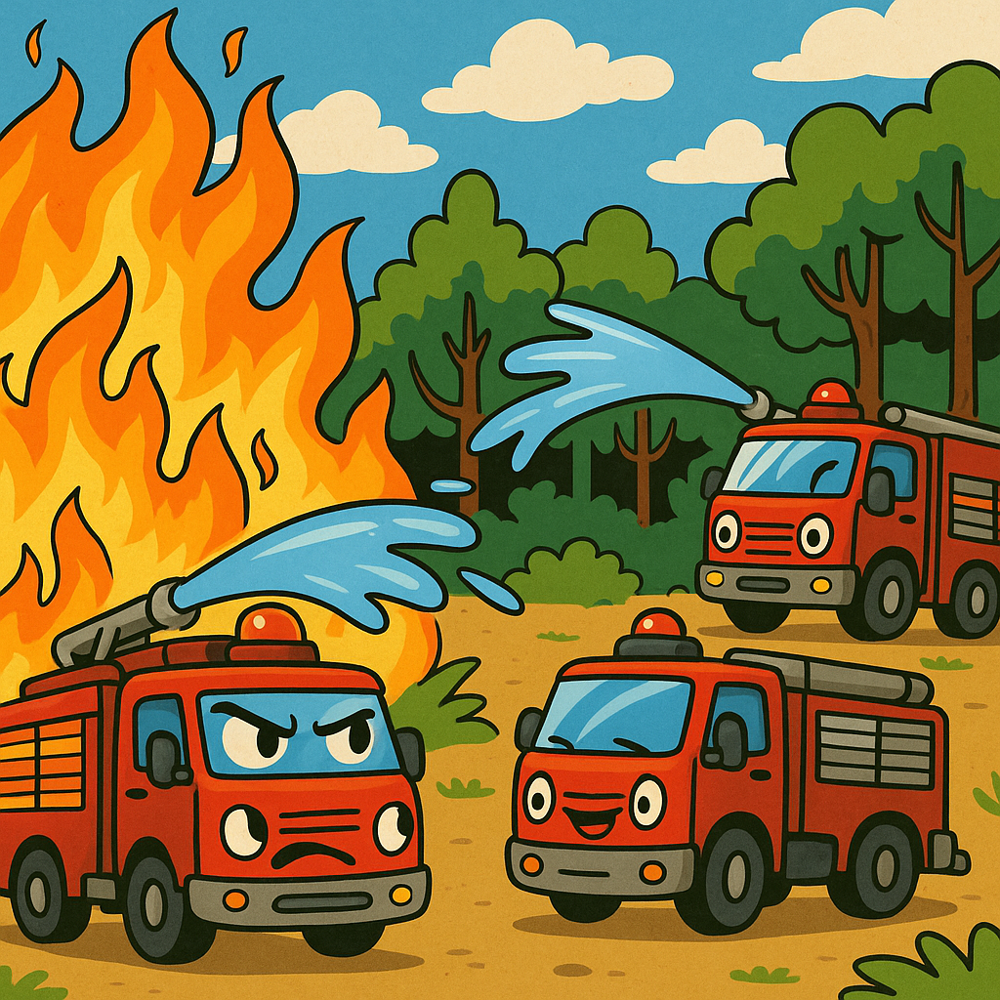

# DIT357 Lab Template — Fighting Forest Fires with Distributed Messaging



## About
This repository is the starting point for the DIT357 Distributed Systems lab "Fighting Forest Fires with Distributed Messaging". You will build a decentralised system where independent fire trucks coordinate (without the help of a central controller) to extinguish fires spreading across a 20×20 grid, using TCP, NATS request-reply, NATS publish-subscribe, and Lamport logical clocks along the way.

The full lab specification [DIT357_Lab.pdf](DIT357_Lab.pdf) is the source for every task's requirements and deliverables. This **README** covers how to get the template running and how the repository is organised and it does **NOT** replace the lab's PDF.

## Getting started

Fork this repository into your own group's space (or clone it directly, depending on how your group is set up).

1. Clone your fork:

```bash
   git clone https://git.chalmers.se/heyn/dit357_lab
   cd <directory-name>
```

2. Run the Part 0 template:
```bash
   go run task-0-template.go
```
You should see a 20×20 grid redrawing in place roughly every 0.6 seconds, with two trucks roaming the grid and fighting fires.

No code changes are required to complete Part 0. The template is a complete and working simulation on its own. Part 0 is about reading and understanding it (see below), not extending it. Your own code starts in Part 1.

## What's in the template

**task-0-template.go** implements, as a single sequential Go program:

- 20×20 grid where cell (0,0) is the fire department and fires cannot ignite
- fires that ignite at random, intensify over time, and periodically spread to their neighbouring cells
- two trucks that move around the grid, seek out the nearest fire, and extinguish it by spending on-board water;
- a truck that runs out of water heading back to the fire department and idling there - refilling is not implemented
- a console renderer that redraws the grid in place each timestep.

All the tunable simulation constants (grid size, how often fires spread and intensify, truck water capacity, refill rate, number of trucks, etc.) are declared together near the top of the file and are documented there.

There is no messaging or networking of any kind in the Part 0 template — that is intentional. It exists as the centralised, single-process baseline that the rest of the lab pulls apart into an actual distributed system.

## Lab structure

The lab is split into six parts. Part 0 uses this template as-is; Parts 1–4 build the distributed system on top of it in stages; Part 5 is your final presentation and demo. See [DIT357_Lab.pdf](DIT357_Lab.pdf) for full task descriptions, diagrams, and deliverables for each part.

- Part 0 (Est. time ~2 h) - Read and understand the provided template. No code changes.
- Part 1 (Est. time ~8 h) - Design and implement an application-layer protocol over raw TCP so trucks can request water refills from a fire-department server.
- Part 2 (Est. time ~6 h) - Capture your Part 1 protocol's traffic with Wireshark and connect it to what you know about TCP from the lectures.
- Part 3 (Est. time ~12 h) - Migrate the refill channel to NATS request-reply; design a naming scheme for trucks and fire locations; implement a decentralised, NATS publish-subscribe "call for help" protocol so trucks can coordinate on big fires without a central decision-maker; add on-demand truck deployment and fuel-saving behaviour.
- Part 4 (Est. time ~6 h) - Add Lamport logical clocks so the fire department grants the shared water reservoir fairly, in "who asked first" order.
- Part 5 (Est. time ~6 h) - Present your architecture and design decisions, with a live demo.

## Getting help
If you have any questions or get stuck at any point, contact your assigned TA.

