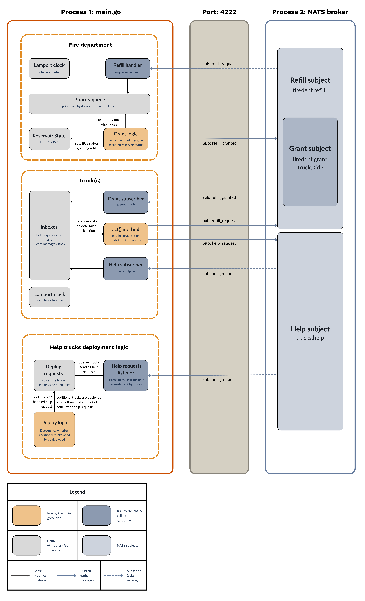
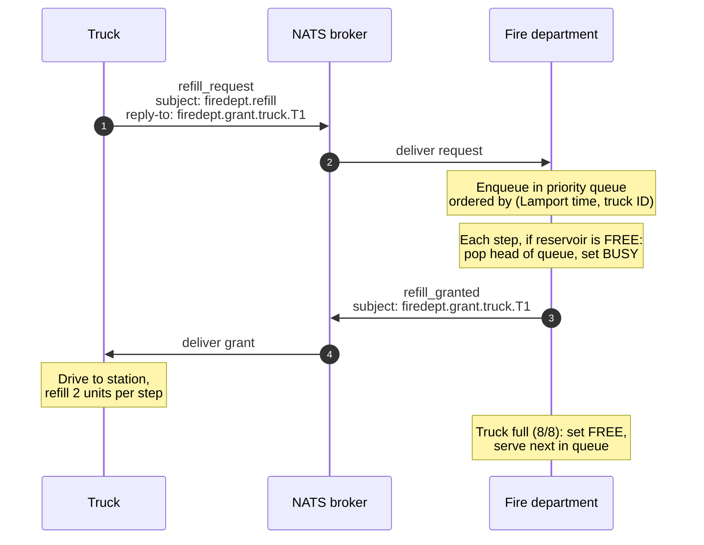
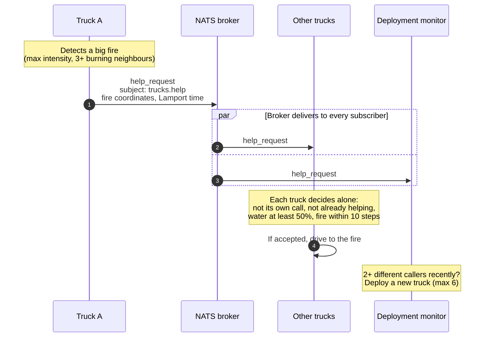

# DIT357 Lab Group 6 — Fighting Forest Fires with Distributed Messaging

A decentralised fire-fighting simulation in Go. Independent fire trucks coordinate over a [NATS](https://nats.io) message broker, to put out fires spreading across a 20×20 forest grid. Built for the DIT357 Distributed Systems course (Chalmers / University of Gothenburg) as a four-person group project. <br><br>

<br><br>

> [!IMPORTANT]
> The first version of the refilling protocol was built using raw tcp. This version can be found in the [tcp-version](https://github.com/Shrinidhi253/FireserviceSystem/tree/tcp-version) branch.

## What happens in the system:
1. **Fire dynamics:** Fires ignite randomly, intensify over time, and spread to neighbouring cells.

2. **Refilling:** Each fire truck carries <u>8 units</u> of water. Extinguishing a fire consumes water. When the truck runs out of water, there is one shared water reservoir in the fire department. The reservoir can <u>fill only 1 truck at a time</u>.  Trucks send a refill request to the fire department which grants refill in a fair order.

3. **Decentralised call-for-help:** If trucks see a big fire, they call other trucks for assistance. Every other truck decides on its own based on its current status whether to respond to the call for help.

4. **Dynamic field trucks:** If fire department sees that several trucks are simultaneously calling for help, additional trucks will be deployed on the field (maximum 6).

5. **Fuel saving:** If no fire has been detected for a while, the trucks return to the fire department and remain idle there (only if there are enough trucks on the field.)

6. **Truck logs:** Every truck's actions including their lamport timestamps is logged into a per-truck log named `<truck_id>.log` in the `/logs/` directory.


## System architecture

<br><br>
**The architecture is hybrid of:**

1. **Client-server:** A single centralised server which controls how the fire department's resources are allocated (i.e. decides which truck gets refill an when a new truck is deployed on field)

2. **Publish-subscribe:** The trucks respond to the call-for-help without the waiting for the fire department to interfere. All trucks receive the help request without the sender truck knowing the receiver truck's id and other attributes.  

## Protocols
### Message catalogue
| Type | From -> To | Subject | JSON fields |
| ---- | ---------- | ------- | ----------- |
|`refill_request`| truck -> fire department | `firedept.refill`.| `type`, `truck_id`, `lamport_time`|
|`refill_grant`| fire department -> truck | `firedept.grant.truck.<id>`|`type`, `truck_id`, `lamport_time`|
|`help_request`| truck -> all trucks | `trucks.help` | `type`, `truck_id`, `fire_id`, `x`, `y`, `lamport_time` |

```json
//Example help request
{"type":"help_request", "truck_id":"T1", "fire_id": "fire.11.7", "x": 11, "y": 7, "lamport_time": 142}
```

### Refill protocol - message sequence diagram


### Call-for-help protocol - message sequence diagram


## Running the program

**Prerequisites:**<br>
1. [Go (version 1.18 or higher)](https://golang.or/dl/)
2. [Docker](https://docs.docker.com/get-docker/)


```bash
#Clone this repository
cd <to your preferred directory>

git clone https://github.com/Shrinidhi253/FireserviceSystem.git

cd FireserviceSystem
```

```bash
#Install the official Go client for NATS
go get github.com/nats-io/nats.go
```

```bash
#Start the local NATS server (make sure Docker, e.g. Docker desktop is running)
docker run -d --name nats-server -p 4222:4222 nats

#Run the go program
go run .
```

```bash
#After the go program terminates, stop the nats-server.
docker stop nats-server
docker rm nats-server
```

## Development process and Usage of AI
It was agreed in our team contract that all members of the team may choose to use AI in the project as they will.

However, the main design decisions such as protocol design and architecture were decided in sprint planning meetings and evaluated in the sprint review and retrospectives.

The code generated by AI was reviewed and tested against specific acceptance criteria defined in our issues before merging to main.

## Limitations and Future work
This system mentioned earlier was made as a part of a 1.5hp lab project in a university course. Due to the lack of sufficient time, some parts of the system were not prioritised as much.

In this github repository, I will be extending the system that was created in the course by fixing bugs which were low priority for the assignment but impacts system quality. I will also be extending with new features that could enhance the overall system.

Some limitations that will be worked on are as follows:
1. **Centralised server and single point of failure:** If the server crashes, all trucks will come to halt. Multiple fire departments each with its own queue could help with the problem as the trucks would have other alternatives.

2. **No distinction between server crashing and waiting in queue:** Currently in the NATS implementation, the trucks send a request and wait indefinitely until they receive a grant. In the TCP implementation, the trucks would resend request after a timeout. In both versions, the trucks would not know if the server is not responding because it is busy or because it has crashed. Maybe the server could update the position of the truck in the queue.

3. **Help is sent to all trucks:** Only some trucks can in reality offer help. The other trucks' inbox will be flooded with help requests they cannot offer. To solve this, the world could be divided into zones and a truck could publish help request only for its own zone.


## Team
1. Ifty Zubaer
2. Josefina Faundez Reyes
3. Lei Zhou
4. Shrinidhi Ganapathi